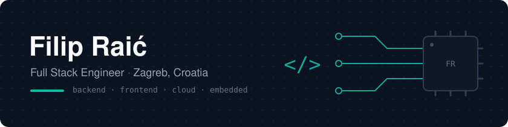
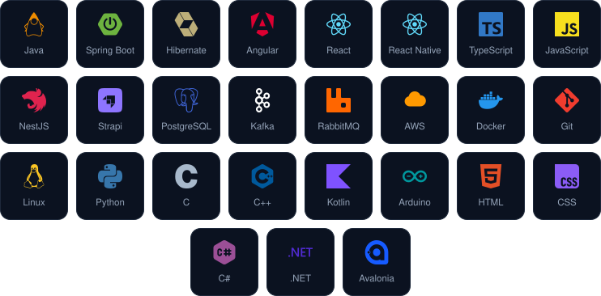
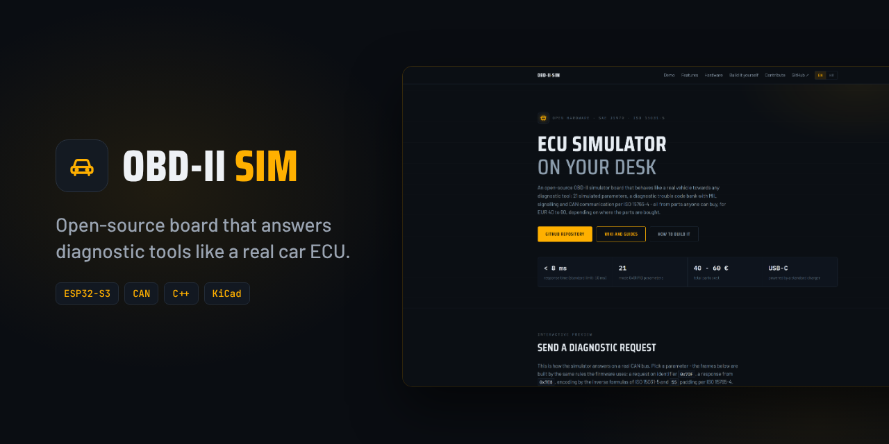
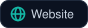
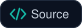
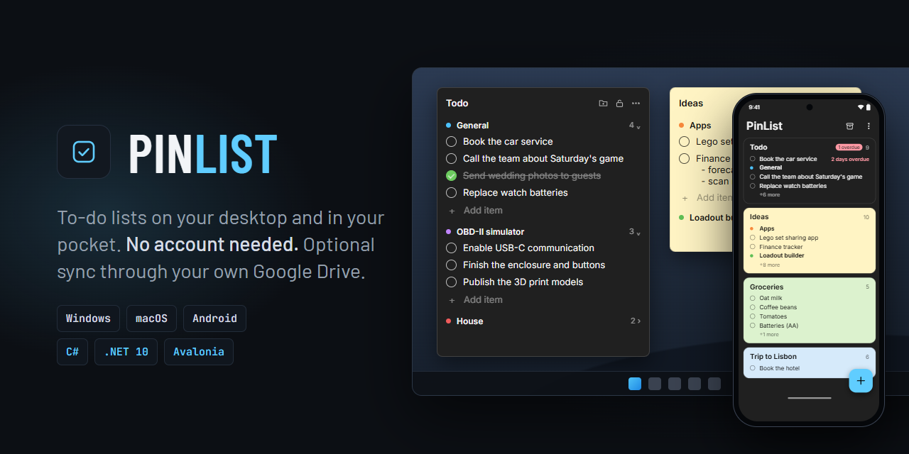
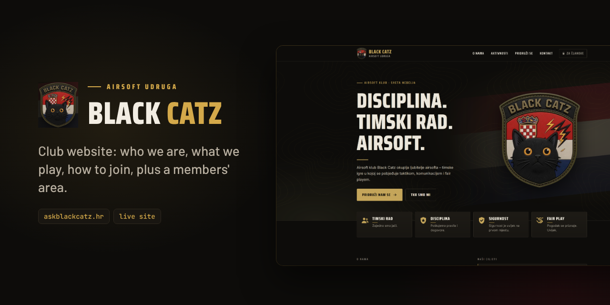
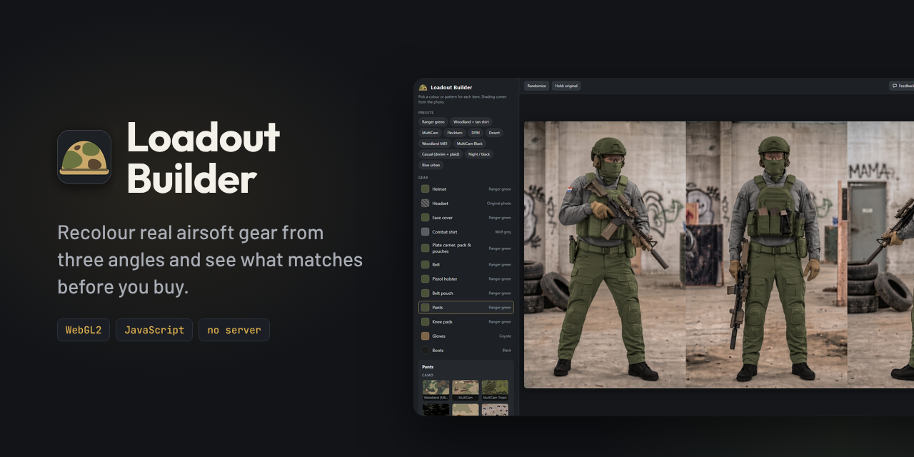
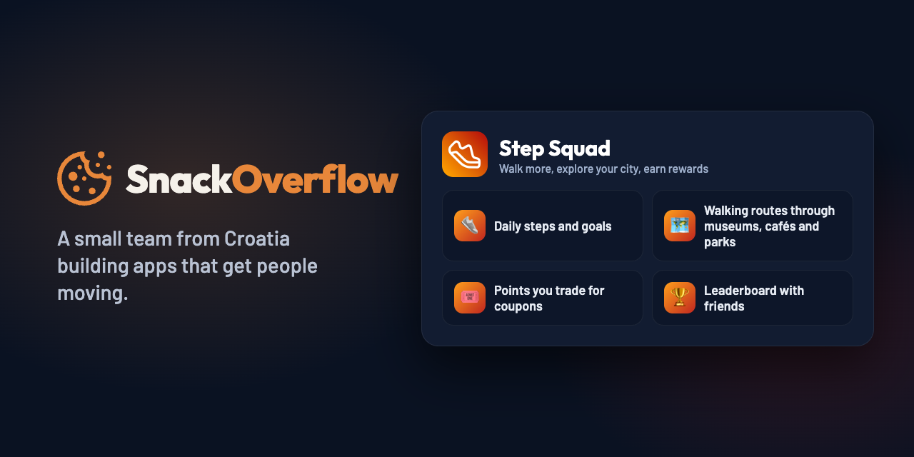

  
  

Hi, I'm Filip, a full stack engineer and I enjoy working on projects that need ownership across the entire lifecycle, from planning,
analysis and risk assessment, through development, deployment and long-term maintenance.

## Tech I use

  

## Things I've built

<table>
  <tr>
    <td width="50%" valign="top">
      
      <h3><a href="https://filipraic.github.io/obd2-simulator/">OBD-II simulator</a></h3>
      
Open-source ECU simulator board that answers diagnostic tools like a real car ECU: 21 live parameters, fault codes and a MIL. &nbsp;

      
<code>ESP32-S3</code> <code>CAN</code> <code>C++</code>

      
      
    </td>
    <td width="50%" valign="top">
      
      <h3><a href="https://filipraic.github.io/pin-list/">PinList</a></h3>
      
To-do list widgets for the Windows and macOS desktop, plus an Android app. Categories, drag-and-drop, due dates, reminders, archive and optional Google Drive sync.

      
<code>C#</code> <code>.NET</code> <code>Avalonia</code>

      
      
    </td>
  </tr>
  <tr>
    <td width="50%" valign="top">
      
      <h3><a href="https://www.askblackcatz.hr">ASK Black Catz</a></h3>
      
Website for an airsoft club with activities, membership info and a members-only admin area.

      
<code>HTML</code> <code>CSS</code>

      
    </td>
    <td width="50%" valign="top">
      
      <h3><a href="https://filipraic.github.io/loadout-builder/">Loadout builder</a></h3>
      
Website for trying different airsoft gear patterns and colors on a 3-angle photo, so you can see what matches before buying.

      
<code>JavaScript</code> <code>Python</code> <code>WebGL2</code>

      
      
    </td>
  </tr>
  <tr>
    <td colspan="2" align="center" valign="top">
       
      <a href="https://github.com/SnackOverflow-com"><b>Step Squad</b></a> · team project by SnackOverflow 
      Mobile app centered around walking with step tracking, city routes, points, leaderboards, badges and streaks. Built as a team project with SnackOverflow.  
      <code>React Native</code> <code>NestJS</code> <code>PostgreSQL</code>
    </td>
  </tr>
</table>

Take a look at some of the other [repositories](https://github.com/FilipRaic?tab=repositories) I have published over the years.
