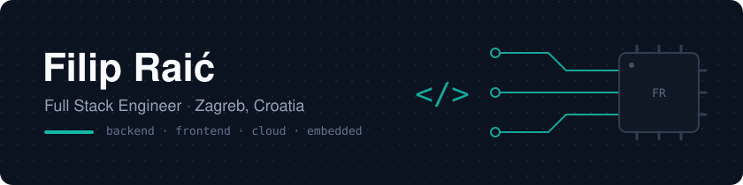
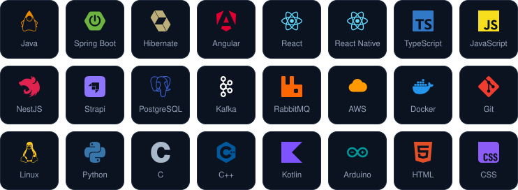
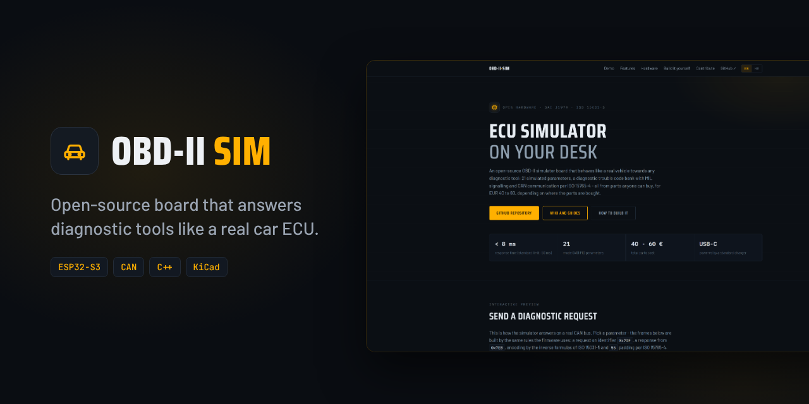
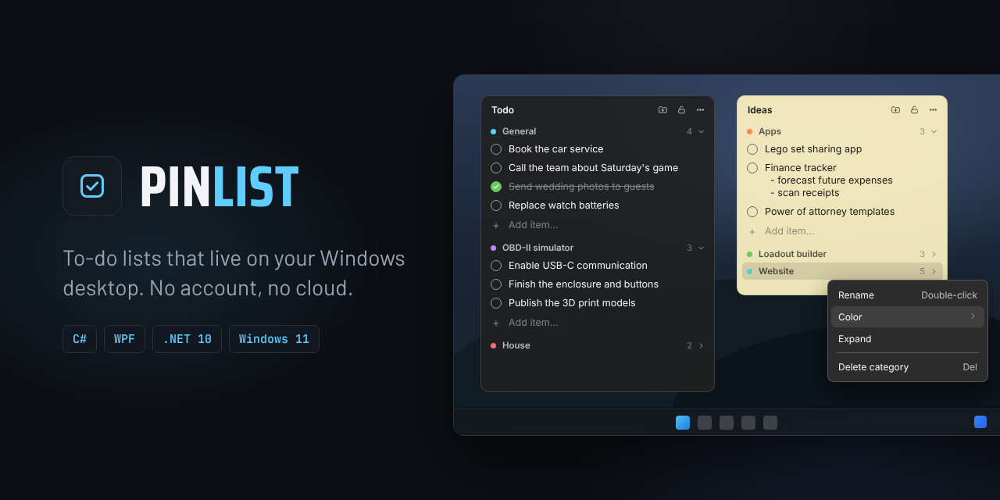
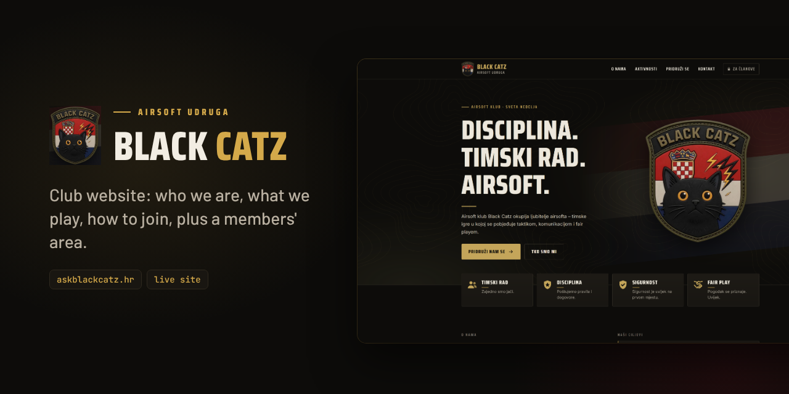
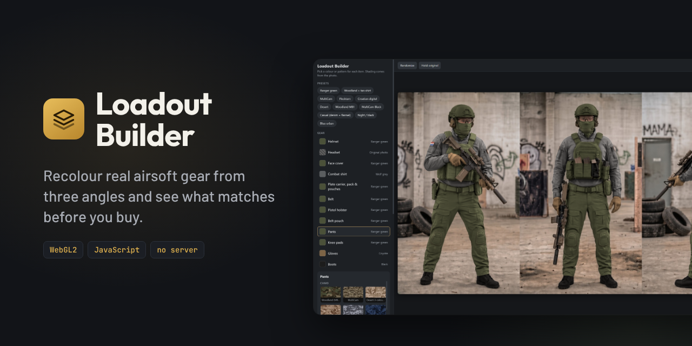
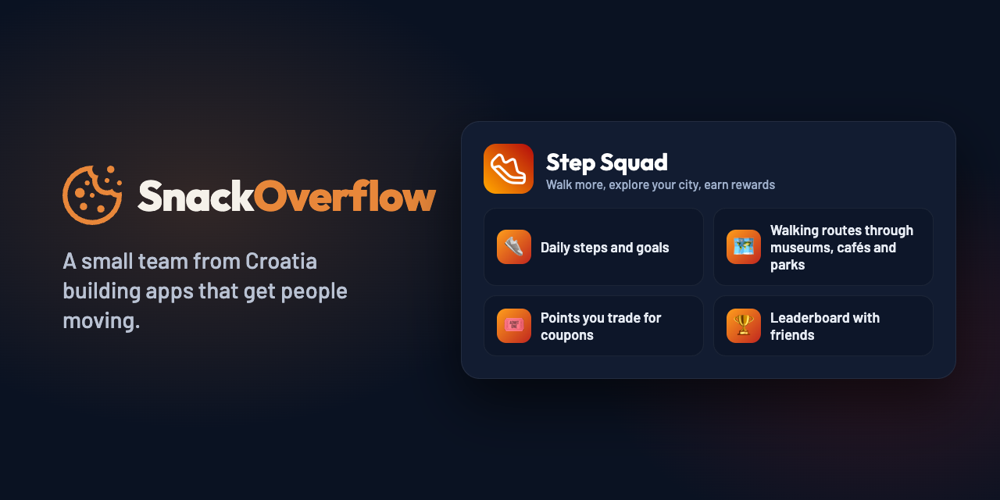

  
  

Hi, I'm Filip, a full stack engineer and I enjoy working on projects that need ownership across the entire lifecycle, from planning,
analysis and risk assessment, through development, deployment and long-term maintenance.

## Tech I use

  

## Things I've built

<table>
  <tr>
    <td width="50%" valign="top">
       
      <a href="https://filipraic.github.io/obd2-simulator/"><b>OBD2 simulator</b></a> 
      Open-source ECU simulator board that answers diagnostic tools like a real car ECU: 21 live parameters, fault codes and a MIL.  
      <code>ESP32-S3</code> <code>CAN</code> <code>C++</code>
    </td>
    <td width="50%" valign="top">
       
      <a href="https://github.com/FilipRaic/pin-list"><b>PinList</b></a> 
      To-do list widgets pinned to your Windows desktop. Categories, drag-and-drop, archive of completed items. No account, no cloud, your data stays on your PC.  
      <code>C#</code> <code>.NET</code> <code>WPF</code>
    </td>
  </tr>
  <tr>
    <td width="50%" valign="top">
       
      <a href="https://www.askblackcatz.hr"><b>ASK Black Catz</b></a> 
      Website for an airsoft club with activities, membership info and a members-only admin area.  
      <code>HTML</code> <code>CSS</code> <code>live site</code>
    </td>
    <td width="50%" valign="top">
       
      <a href="https://github.com/FilipRaic/loadout-builder"><b>Loadout builder</b></a> 
      Website for trying different airsoft gear patterns and colors on a 3-angle photo, so you can see what matches before buying.  
      <code>JavaScript</code> <code>Python</code> <code>WebGL2</code>
    </td>
  </tr>
  <tr>
    <td colspan="2" align="center" valign="top">
       
      <a href="https://github.com/SnackOverflow-com"><b>Step Squad</b></a> · team project by SnackOverflow 
      Mobile app centered around walking with step tracking, city routes, points, leaderboards, badges and streaks.  
      <code>React Native</code> <code>NestJS</code> <code>PostgreSQL</code>
    </td>
  </tr>
</table>

Take a look at some of the other [repositories](https://github.com/FilipRaic?tab=repositories) I have published over the years.
